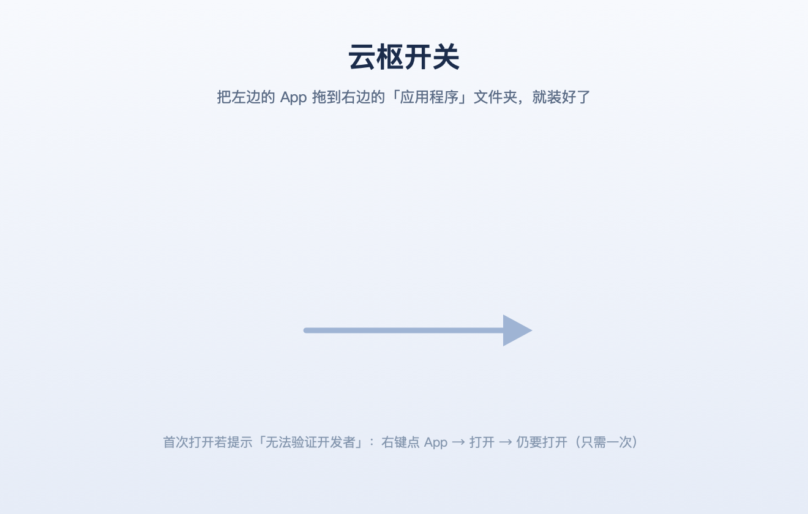

<div align="center">


# 云枢开关 · YunShuSwitch

**给 macOS 上的「云枢 Yunshu」加一个开关：点一下连上公司内网，再点一下彻底断开并禁用守护进程。**


[下载安装](#-下载安装30-秒) · [怎么用](#-怎么用) · [常见问题](#-常见问题) · [从源码编译](docs/编译与打包.md) · [实现原理](docs/技术原理.md)

</div>

---

## 这是什么

云枢（Yunshu / eagleyun SASE，`com.eagleyun.sase`）是不少公司在用的内网接入客户端。它装着 3 个 `KeepAlive` 的 launchd 守护进程，退出客户端后它们还会被系统反复拉起，想在「不用内网的时候彻底关掉」很别扭——这也是很多人拿柠檬之类的工具去"禁用进程"的原因，但效果不稳定、状态也不透明。

这个项目做了两件事，都基于 **launchd 原生的启用/禁用**，随时可逆：

| 操作 | 内部做了什么 |
|---|---|
| **连接内网** | 启用并拉起 3 个守护进程 → 拉起用户级代理 → 启动云枢主程序 → 在云枢界面自动点「连接网络」→ 校验隧道与路由（约 5 秒） |
| **断开并禁用** | 断开隧道 → 退出主程序 → 停止并 **禁用** 3 个守护进程 → 清残留进程 → 校验路由已清除（约 3 秒） |

`down` 之后重启电脑也不会被拉起，`up` 能完整还原，不用重装云枢。

---

## 📦 下载安装（30 秒）

**① 下载安装盘** → [**Releases · 最新版 YunShuSwitch.dmg**](../../releases/latest)（约 700 KB）

> 也可以直接用仓库里的 [`dist/YunShuSwitch.dmg`](dist/YunShuSwitch.dmg)（本机构建，带背景排版；Release 里的是 CI 构建，仅少一层背景图）。

**② 双击打开，把左边的「云枢开关」拖到右边的「应用程序」**

<div align="center"></div>

**③ 双击运行，按弹窗做完两件事（各一次，之后不再打扰）**

| 弹窗 | 你要做的 | 为什么 |
|---|---|---|
| 欢迎使用云枢开关 · 还差一步配置 | 点「立即配置」，输入**一次**开机密码 | 装一个只允许启停云枢守护进程的受限 root 助手，之后免密 |
| 需要「辅助功能」权限 | 点「打开系统设置」，在列表里勾选「云枢开关」 | 让它能替你在云枢界面点「连接网络」 |

> 首次打开若提示「无法验证开发者」：在 App 上**右键 → 打开 → 仍要打开**（只需一次）。
> 这是因为安装包用个人开发证书签名，没有走 App Store 公证。

菜单栏出现云朵图标就装好了，没有 Dock 图标、不占后台常驻内存（约 20 MB）。

### 系统要求

| 项目 | 要求 |
|---|---|
| 芯片 | Apple Silicon（M1/M2/M3/M4）；Intel 需自行改 `build.sh` 的 `-target` 重编译 |
| 系统 | macOS 13 或更高（在 macOS 27 上实测） |
| 云枢 | 2.6.x（实测 2.6.1.33），装在同一台机器上 |

---

## 🖱 怎么用

### 方式 A：菜单栏（推荐）

点菜单栏的云朵图标：

```
云枢：已连接企业内网          ← 实时状态，每 8 秒刷新
────────────────────
连接内网（启动并连接）         ← 一键恢复 + 自动连接
断开并禁用（彻底退出）         ← 断隧道、退程序、禁守护进程（会二次确认）
────────────────────
刷新状态             ⌘R
打开日志目录
一键修复（免密/授权）
安装命令行工具（ysctl）
辅助功能权限设置…
诊断：导出云枢界面元素
```

### 方式 B：命令行

App 首次启动时会把内置的 `ysctl` 链接到 `~/.local/bin/ysctl`：

```bash
ysctl up            # 启动 + 连接
ysctl down -y       # 断开 + 退出 + 禁用（-y 跳过确认）
ysctl toggle        # 连着就断，断着就连
ysctl status        # 详细状态
ysctl state         # 只输出 connected / idle / off
ysctl fix           # 一键修复：免密规则 + 辅助功能 + 自检
ysctl doctor        # 环境自检
```

嫌长就加别名（`~/.zshrc`）：

```bash
alias ysu='ysctl up'
alias ysd='ysctl down -y'
```

> 终端提示 `command not found: ysctl`？加一行 `export PATH="$HOME/.local/bin:$PATH"` 到 `~/.zshrc`。

### 方式 C：快捷指令 / 快捷键

「快捷指令」App → 新建 → 「运行 Shell 脚本」→ 内容填 `$HOME/.local/bin/ysctl toggle`，就能绑到快捷键或菜单栏。

---

## 🔧 从源码编译

需要：macOS + Xcode Command Line Tools（`xcode-select --install`）。**没有任何第三方依赖**。

```bash
git clone git@github.com:shiwuhao/YunShuSwitch.git
cd YunShuSwitch

./build.sh        # 编译菜单栏 App → build/YunshuSwitch.app
./install.sh      # 装到 ~/Applications + 链接 ysctl + 启动
./make-dmg.sh     # 打包安装盘 → dist/YunShuSwitch.dmg
```

完整说明（签名、图标重生成、DMG 排版原理、CI）见 **[docs/编译与打包.md](docs/编译与打包.md)**。

---

## 📁 项目结构

```
YunShuSwitch/
├── bin/ysctl              核心 CLI（zsh，纯系统命令，无依赖）
├── ui/YunshuSwitch.swift  菜单栏 App（含 Accessibility 点击逻辑）
├── ui/Info.plist          App 描述文件（LSUIElement = 纯菜单栏）
├── ui/AppIcon.icns        图标（由 tools/Artwork.swift 生成）
├── lib/yunshu-priv        受限 root 助手（只做守护进程启停）
├── lib/ui.applescript     旧版 osascript 方案，仅作无 App 时的退路
├── assets/使用说明.txt     随 DMG 分发的说明
├── tools/Artwork.swift    用 CoreGraphics 画图标 + 安装盘背景
├── tools/mkdsstore.py     直接写 .DS_Store（免 Finder 自动化授权）
├── build.sh               编译 App
├── install.sh             安装 / 卸载
├── make-dmg.sh            打包安装盘
├── dist/YunShuSwitch.dmg  已编译好的安装盘
└── docs/                  编译打包、技术原理、排障
```

---

## ❓ 常见问题

| 现象 | 原因与处理 |
|---|---|
| 每次连接/断开都要输密码 | 免密助手没装好 → 菜单栏「一键修复（免密/授权）」，或 `ysctl fix` |
| 点了连接，云枢起来了但没连上 | 冷启动第一次点击可能被云枢静默忽略；程序会自动补点、必要时重启云枢再点，也可以再点一次 |
| 菜单栏点了没反应 | 上一次操作卡在系统密码框里，等它超时收尾（最多 150 秒）再点 |
| 菜单栏没有图标 | 菜单栏排满了，按住 ⌘ 拖动调整顺序或隐藏几个图标 |
| 想让工具开机自启 | 系统设置 → 通用 → 登录项 → 添加「应用程序」里的「云枢开关」 |

更细的排障（含日志对照表、`NOBTN`/`-25211`/`-10004` 等具体报错）见 **[docs/排障.md](docs/排障.md)**。

---

## 🗑 卸载

```bash
ysctl up        # 先恢复正常，避免管理后台显示离线
ysctl unsetup   # 移除免密助手（/usr/local/sbin/yunshu-priv 与 sudoers 规则）
```

然后把「应用程序」里的「云枢开关」拖进废纸篓，需要的话再删 `~/Library/Logs/YunshuSwitch` 和 `~/Library/Application Support/YunshuSwitch`。

---

## 🔒 安全边界与免责

- **不改云枢安装包、不破解、不拦截流量**，只操作 launchd 的 `enable/disable` 状态，随时可 `up` 还原；
- 提权只通过一个**受限 root 助手**：只接受 `check` / `up` / `down` 三个子命令，路径全写死，不拼接外部参数；
  sudoers 规则也只放行这三条精确命令（`/etc/sudoers.d/yunshu-switch`），不给通用 `sudo`；
- 界面点击由本 App 自己用 Accessibility API 完成，不依赖「自动化」权限，也不给终端额外权限；
- **云枢是公司管控软件。** 禁用后设备在管理后台会显示离线，可能触发合规告警，请在公司制度允许的范围内使用；把机器交给 IT 排障前请先 `ysctl up`。

---

## 📚 文档

| 文档 | 内容 |
|---|---|
| [docs/编译与打包.md](docs/编译与打包.md) | 从零编译、签名、重生成图标、DMG 排版内幕、GitHub Actions |
| [docs/技术原理.md](docs/技术原理.md) | 云枢的进程结构、launchd 双域操作、提权模型、CLI↔App 通信、性能剖析 |
| [docs/排障.md](docs/排障.md) | 症状 → 原因 → 处理，附日志对照表 |
| [CHANGELOG.md](CHANGELOG.md) | 版本变更记录 |

---

## 许可

[MIT](LICENSE)。与云枢 / 亿格云官方无关，纯个人效率工具。
